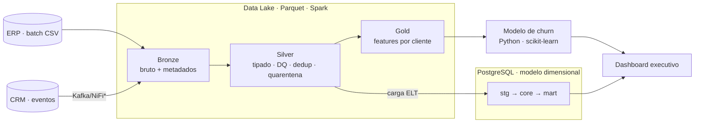
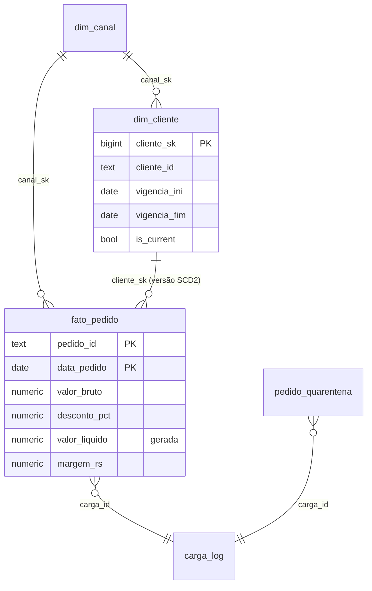

# Arquitetura

\* No protótipo, o streaming usa Structured Streaming sobre micro-lotes JSON; em produção a fonte vira `format("kafka")`.

## Modelo dimensional (core)

## Decisões de projeto
| Decisão | Motivo |
|---|---|
| Fato particionada por mês | Poda de partições nas consultas por período e manutenção/retensão barata por partição |
| SCD2 com `EXCLUDE USING gist` | O banco impede duas versões vigentes do mesmo cliente, sem depender do ETL |
| Quarentena com motivos em `text[]` + JSON original | Nada é descartado; o registro pode ser corrigido e reprocessado |
| Colunas geradas (`valor_liquido`) | Regra de cálculo única, não dá para divergir entre relatórios |
| RLS por canal | Gestor de canal só enxerga o próprio canal, aplicado no banco e não na aplicação |
| Gold sem vazamento | Features só até a data de corte; o rótulo de churn olha o trimestre seguinte |
| BRIN + B-tree com `INCLUDE` | BRIN para varredura por data (barato); B-tree cobrindo a consulta por cliente |

## Reconciliação entre as duas pontas (mesmos dados sintéticos)
| Verificação | Spark (lake) | PostgreSQL (DW) |
|---|---|---|
| Registros brutos | 51.366 | 51.366 |
| Duplicados removidos | 609 | 609 |
| Linhas válidas na Silver / `fato_pedido` | 49.603 | 49.597 |
| Clientes na Gold / `fn_features_churn` | 2.266 | 2.266 |
| Taxa de churn no rótulo | 20,2% | 20,2% |

A diferença de 6 linhas na Silver tem origem na deduplicação: 32 dos 609 pedidos duplicados têm cópias que divergem em validade
(a sujeira foi injetada depois de duplicar), e cada motor escolhe uma cópia diferente (o Spark mantém uma qualquer entre cópias
com o mesmo `_ingest_ts`; o PostgreSQL mantém a de maior `ingest_id`). Em produção isso se resolve com uma chave de ordenação
determinística na origem (por exemplo, versão ou timestamp do evento).
